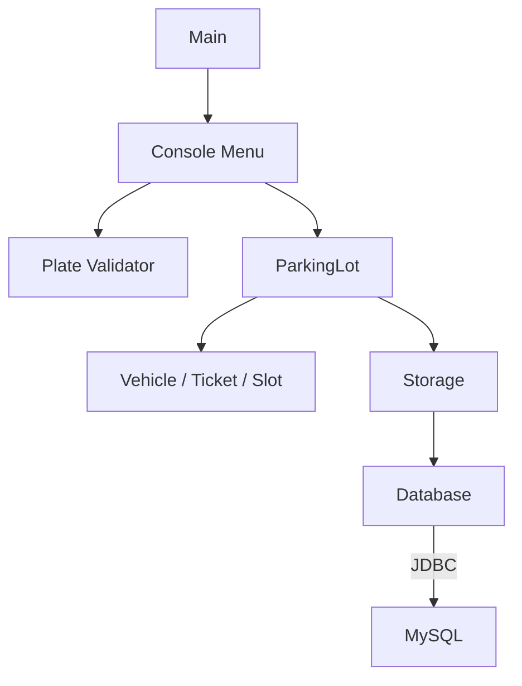
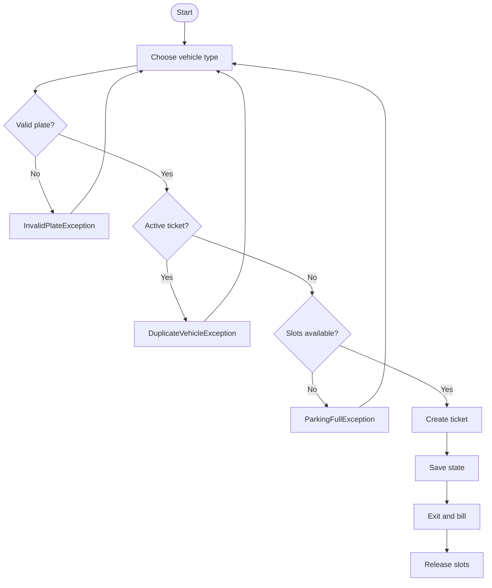

# ParkEase

ParkEase is a Java console application for a 20-slot parking lot. It handles entry, exit
and billing for bikes, cars and trucks, and stores vehicles, tickets and slot state in MySQL
through JDBC.

For API details, class and object relationships, Java and MySQL data types, and exception
behavior, see [TECHNICAL_GUIDE.md](TECHNICAL_GUIDE.md).

## Requirements

- JDK 17 LTS or newer
- MySQL 8.4 LTS or 9.7 LTS
- MySQL Connector/J 26.7.0

If `java -version` is older than 17, set `JAVA_HOME` to a JDK 17 LTS or newer installation before running the scripts.

## Build

1. Put the MySQL driver here:

   ```text
   lib/mysql-connector-j-26.7.0.jar
   ```

   Download it from <https://dev.mysql.com/downloads/connector/j/>.

2. Compile the source from the project folder.

   Windows:

   ```bat
   build.bat
   ```

   macOS / Linux:

   ```bash
   chmod +x build.sh
   ./build.sh
   ```

   The compiled classes are written to `out/classes`.

   The Windows batch files pause when they finish so errors stay visible. Use
   `build.bat nopause` or `run.bat nopause` to skip the pause.

## Configure MySQL

The default connection is:

```text
URL      jdbc:mysql://localhost:3306/parkease?createDatabaseIfNotExist=true&useSSL=false&allowPublicKeyRetrieval=true&serverTimezone=Asia/Kolkata&characterEncoding=UTF-8
User     root
Password (empty)
```

Start MySQL before running the app. For local development, copy `.env.example` to `.env`.

Windows:

```bat
copy .env.example .env
```

macOS / Linux:

```bash
cp .env.example .env
```

Then set these values in `.env`:

```text
PARKEASE_DB_URL
PARKEASE_DB_USER
PARKEASE_DB_PASSWORD
```

The `.env` file is ignored by Git. In production, do not ship `.env`; set the same variables
in the deployment environment. Real environment variables override `.env`.

## Run

Start the app from the project folder.

Windows:

```bat
run.bat
```

macOS / Linux:

```bash
chmod +x run.sh
./run.sh
```

`run.bat` and `run.sh` build the project and then start the app. The first run creates the
`parkease` database, its tables and the 20 slots.

## Menu

```text
1 - Park a vehicle
2 - Exit a vehicle
3 - View slot map
4 - View summary
5 - Quit
```

The park flow shows vehicle rates and slot requirements before entry, and the ticket
number is required for exit. The slot map uses a 5-column grid. `FREE` means the slot
is available; occupied cells show the plate and a type code: `B` bike, `C` car, `T` truck.

## Architecture



## Parking flow



## Parking rules

| Vehicle | Menu | Rate | Slots | Cap |
|---------|------|------|-------|-----|
| Bike | `1` | Rs. 10/hour | 1 | 8 hours |
| Car | `2` | Rs. 30/hour | 1 | 8 hours |
| Truck | `3` | Rs. 60/hour | 2 consecutive | 8 hours |

Examples:

```text
Car, 2.5 hours   -> 3 x Rs. 30 = Rs. 90
Truck, 12 hours  -> 8 x Rs. 60 = Rs. 480
Bike, 0.5 hours  -> 1 x Rs. 10 = Rs. 10
```

Other rules:

- Partial hours are rounded up with `Math.ceil`.
- The billable time is capped at 8 hours.
- A truck needs two consecutive free slots.
- A plate cannot have two active tickets.
- When no slot is free, the app throws `ParkingFullException` and the menu prints the error.
- Ticket numbers start at `T-1001`. A static counter in `Ticket` supplies the next number
  and continues from `MAX(ticket_no)` after a restart.
- Entry and exit times use IST and AM/PM.
- Dates use `dd-MMM-yyyy`.
- Charges use `Rs.`.

## Number plates

The validator accepts the Indian plate format:

- 2 letters for the state code
- 2 digits for the RTO code
- 1 or 2 letters for the series
- 4 digits for the serial number

Example: `TN37AB1234`

| Part | Meaning |
|------|---------|
| `TN` | State code |
| `37` | RTO code |
| `AB` | Series |
| `1234` | Serial number |

Accepted examples:

```text
TN37AB1234
KA01A1234
TN 37 AB 1234
```

Spaces, hyphens and letter case are ignored, so `tn 37-ab-1234` is accepted as
`TN37AB1234`.

Rejected examples:

```text
TN3AB1234      RTO code is not 2 digits
TN37ABC1234    series is not 1 or 2 letters
TN37AB123     serial number is not 4 digits
```

Invalid plates raise `InvalidPlateException`.

## Database

The app creates and uses three tables:

| Table | Data |
|-------|------|
| `vehicles` | Plate, owner and vehicle type |
| `tickets` | Ticket number, entry and exit times, hours, charge and status |
| `slots` | Slot number and the active ticket that uses it |

Parking and exit update the ticket and slot rows in one transaction. On restart, active
tickets load from MySQL and the ticket counter continues from `MAX(ticket_no)`.

`sql/schema.sql` contains the schema for manual setup. The app creates the schema at startup.

## Exceptions

Each exception is a separate class in `src/parkease/exception`. All of them extend
`Exception`.

| Exception | Raised when |
|-----------|-------------|
| `ParkingFullException` | No free slot or no free pair of consecutive slots is available |
| `InvalidVehicleException` | The vehicle type is missing or unknown |
| `InvalidPlateException` | The number plate is missing or does not match the plate format |
| `InvalidOwnerException` | The owner name is missing |
| `DuplicateVehicleException` | The plate already has an active ticket |
| `InvalidTicketException` | The ticket number is unknown, closed or has bad ticket data |
| `InvalidHoursException` | The hours value is zero or negative |
| `InvalidSlotException` | A slot is occupied, belongs to another ticket or is out of range |
| `StorageException` | The database setup, query or connection fails |

The menu catches these exceptions and prints the message.

## Project layout

```text
ParkEase/
|-- README.md
|-- TECHNICAL_GUIDE.md
|-- LICENSE
|-- .gitignore
|-- .env.example
|-- build.bat
|-- run.bat
|-- build.sh
|-- run.sh
|-- lib/
|   `-- README.md
|-- sql/
|   `-- schema.sql
`-- src/
    `-- parkease/
        |-- Main.java
        |-- console/
        |   `-- Menu.java
        |-- exception/
        |   |-- DuplicateVehicleException.java
        |   |-- InvalidHoursException.java
        |   |-- InvalidOwnerException.java
        |   |-- InvalidPlateException.java
        |   |-- InvalidSlotException.java
        |   |-- InvalidTicketException.java
        |   |-- InvalidVehicleException.java
        |   |-- ParkingFullException.java
        |   `-- StorageException.java
        |-- model/
        |   |-- BikeVehicle.java
        |   |-- CarVehicle.java
        |   |-- Chargeable.java
        |   |-- Slot.java
        |   |-- Ticket.java
        |   |-- TruckVehicle.java
        |   |-- Vehicle.java
        |   `-- VehicleType.java
        |-- service/
        |   `-- ParkingLot.java
        |-- storage/
        |   |-- Database.java
        |   `-- Storage.java
        `-- validation/
            `-- Plate.java
```

The source is split into `console`, `exception`, `model`, `service`, `storage` and
`validation` packages. `Vehicle` is the abstract parent class of `BikeVehicle`, `CarVehicle`
and `TruckVehicle`; it implements the `Chargeable` interface. `VehicleType` holds the rate,
slot count and database code for each type.

The Connector/J jar and the local `.env` file are ignored by Git.

## Common problems

| Problem | Fix |
|---------|-----|
| `Access denied for user` | Set the password in `.env` or `PARKEASE_DB_PASSWORD`. |
| `No suitable driver found` | Put the Connector/J jar in `lib/`. |
| `Communications link failure` | Start MySQL and check the port in `PARKEASE_DB_URL`. |
| `Unknown database 'parkease'` | Keep `createDatabaseIfNotExist=true` or run `sql/schema.sql`. |
| `Public Key Retrieval is not allowed` | Keep `allowPublicKeyRetrieval=true` in the URL. |

## License

MIT. See [LICENSE](LICENSE).
