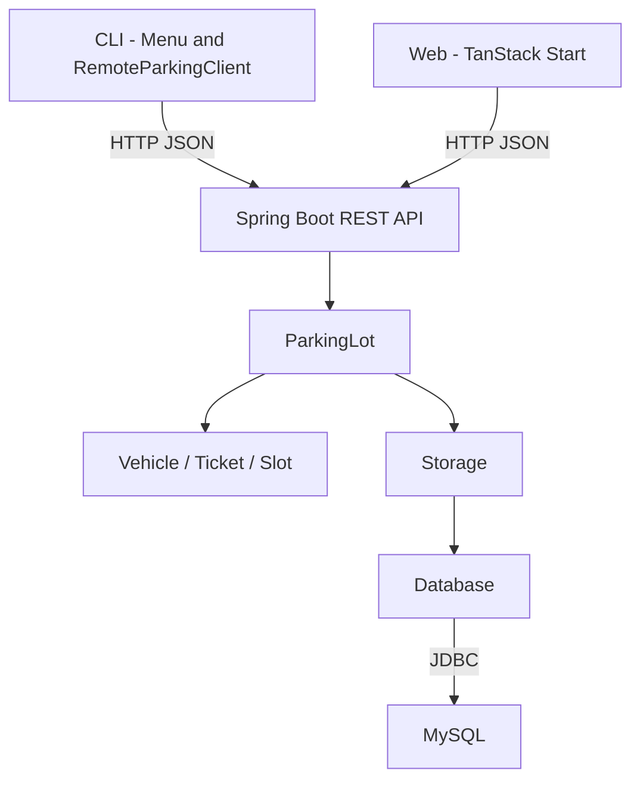

# ParkEase

ParkEase is a full-stack parking application for a 20-slot lot. It handles entry, exit
and billing for bikes, cars and trucks. A Spring Boot backend owns the domain service and
MySQL persistence. A plain-text CLI and a TanStack Start web app both use the same REST
API, so changes made in one client appear in the other.

For class relationships, API details and database behavior, see
[TECHNICAL_GUIDE.md](TECHNICAL_GUIDE.md).

## Architecture



There is one `ParkingLot` bean per backend process. The CLI does not open MySQL directly;
it sends HTTP requests to the backend. The web app uses the same endpoints.

## Requirements

- JDK 17 LTS or newer
- Maven 3.9 wrapper, included in the repository
- MySQL 8.4 LTS or 9.7 LTS
- Bun 1.3 or newer for the web app

If `java -version` is older than 17, set `JAVA_HOME` to a JDK 17 or newer installation
before running the scripts.

## Quick start

### 1. Configure MySQL

Start MySQL. Copy `.env.example` to `.env` and set the connection values:

```text
PARKEASE_DB_URL=jdbc:mysql://localhost:3306/parkease?createDatabaseIfNotExist=true&useSSL=false&allowPublicKeyRetrieval=true&serverTimezone=Asia/Kolkata&characterEncoding=UTF-8
PARKEASE_DB_USER=root
PARKEASE_DB_PASSWORD=
PARKEASE_API_PORT=8080
PARKEASE_API_URL=http://localhost:8080
```

The `.env` file is ignored by Git. Environment variables override `.env`. The backend
creates the database, tables and 20 slot rows on first startup.

### 2. Build and start the backend

Windows:

```bat
build.bat
run.bat
```

macOS / Linux:

```bash
chmod +x build.sh run.sh run-cli.sh mvnw
./build.sh
./run.sh
```

The backend listens on `http://localhost:8080` by default. Override the port with
`PARKEASE_API_PORT`.

The Windows scripts pause when they finish so errors stay visible. Use
`build.bat nopause` or `run.bat nopause` to skip the pause.

### 3. Start the CLI

Keep the backend running, then open another terminal:

Windows:

```bat
run-cli.bat
```

macOS / Linux:

```bash
./run-cli.sh
```

The CLI uses `PARKEASE_API_URL`, or the default `http://localhost:8080`. You can also pass
the address directly:

```bash
./mvnw -q compile exec:java -Dexec.args="--api=http://localhost:8080"
```

### 4. Start the web app

Keep the backend running, then:

```bash
cd frontend
bun install
bun run dev
```

Open <http://localhost:5173>. The web API client defaults to
`http://localhost:8080`. To use a different backend, copy `frontend/.env.example` to
`frontend/.env` and set `VITE_API_URL`.

## Build

The Maven wrapper downloads Maven 3.9.9 on first use. No Maven installation is required.

Windows:

```bat
mvnw.cmd clean package
```

macOS / Linux:

```bash
./mvnw clean package
```

The executable backend jar is written to `target/parkease.jar`. To skip tests while
building a local artifact:

```bash
./mvnw -DskipTests package
```

## CLI menu

```text
1 - Park a vehicle
2 - Exit a vehicle
3 - View slot map
4 - View summary
5 - Quit
```

The park flow shows vehicle rates and slot requirements before entry. The ticket number is
required for exit. The slot map uses a 5-column grid. `FREE` means the slot is available;
occupied cells show the plate and a type code: `B` bike, `C` car, `T` truck.

## REST API

All endpoints are under `/api` and use JSON. Errors use `{ "message": "..." }`.

| Method | Path | Purpose |
|--------|------|---------|
| `GET` | `/api/vehicle-types` | Vehicle codes, names, rates and slot counts |
| `GET` | `/api/slots` | Capacity, free/occupied counts and every slot |
| `GET` | `/api/summary` | Slot, vehicle, ticket and collection totals |
| `POST` | `/api/tickets` | Park a vehicle and issue a ticket |
| `GET` | `/api/tickets/{number}` | Return one active ticket |
| `POST` | `/api/tickets/{number}/exit` | Close, bill and free a ticket |

Park request:

```json
{
  "vehicleType": "CAR",
  "plate": "TN37AB1234",
  "owner": "Asha"
}
```

Exit request:

```json
{
  "hours": 2.5
}
```

Example ticket response:

```json
{
  "ticketNo": 1001,
  "number": "T-1001",
  "plate": "TN37AB1234",
  "owner": "Asha",
  "vehicleType": "CAR",
  "vehicleTypeName": "Car",
  "slots": [1],
  "entryMillis": 1792501850357,
  "hours": 0,
  "charge": 0,
  "active": true
}
```

Status codes:

| Status | Meaning |
|--------|---------|
| `400` | Invalid plate, owner, vehicle type, hours or JSON body |
| `404` | Active ticket not found |
| `409` | Duplicate plate, full lot or slot conflict |
| `500` | MySQL or unexpected backend failure |

## Parking rules

| Vehicle | Rate | Slots | Cap |
|---------|------|-------|-----|
| Bike | Rs. 10/hour | 1 | 8 hours |
| Car | Rs. 30/hour | 1 | 8 hours |
| Truck | Rs. 60/hour | 2 consecutive | 8 hours |

Examples:

```text
Car, 2.5 hours   -> 3 x Rs. 30 = Rs. 90
Truck, 12 hours  -> 8 x Rs. 60 = Rs. 480
Bike, 0.5 hours  -> 1 x Rs. 10 = Rs. 10
```

Other rules:

- Partial hours are rounded up with `Math.ceil`.
- The billable time is capped at 8 hours.
- A truck needs two consecutive free slots.
- A plate cannot have two active tickets.
- Parking and slot updates use one MySQL transaction.
- Ticket numbers start at `T-1001`. The counter continues from `MAX(ticket_no)` after a
  restart.
- Entry and exit times use IST.
- Charges use `Rs.`.

## Number plates

The validator accepts the Indian plate format:

- 2 letters for the state code
- 2 digits for the RTO code
- 1 or 2 letters for the series
- 4 digits for the serial number

Example: `TN37AB1234`

| Part | Meaning |
|------|---------|
| `TN` | State code |
| `37` | RTO code |
| `AB` | Series |
| `1234` | Serial number |

Accepted examples:

```text
TN37AB1234
KA01A1234
TN 37 AB 1234
```

Spaces, hyphens and letter case are ignored, so `tn 37-ab-1234` is accepted as
`TN37AB1234`.

Rejected examples:

```text
TN3AB1234      RTO code is not 2 digits
TN37ABC1234    series is not 1 or 2 letters
TN37AB123     serial number is not 4 digits
```

Invalid plates raise `InvalidPlateException`.

## Database

The backend creates and uses three tables:

| Table | Data |
|-------|------|
| `vehicles` | Plate, owner and vehicle type |
| `tickets` | Ticket number, entry and exit times, hours, charge and status |
| `slots` | Slot number and the active ticket that uses it |

Parking and exit update the ticket and slot rows in one transaction. On restart, active
tickets load from MySQL and the ticket counter continues from `MAX(ticket_no)`.

`sql/schema.sql` contains the schema for manual setup. The backend creates the schema at
startup when `createDatabaseIfNotExist=true` is present.

## Exceptions

Each exception is a separate checked class in `src/parkease/exception`. All of them extend
`Exception`.

| Exception | Raised when |
|-----------|-------------|
| `ParkingFullException` | No free slot or no free pair of consecutive slots is available |
| `InvalidVehicleException` | The vehicle type is missing or unknown |
| `InvalidPlateException` | The number plate is missing or does not match the plate format |
| `InvalidOwnerException` | The owner name is missing |
| `DuplicateVehicleException` | The plate already has an active ticket |
| `InvalidTicketException` | The ticket number is unknown, closed or has bad ticket data |
| `InvalidHoursException` | The hours value is zero, negative, NaN or infinite |
| `InvalidSlotException` | A slot is occupied, belongs to another ticket or is out of range |
| `StorageException` | The database setup, query or connection fails |
| `ApiException` | The CLI cannot reach the backend or receives an HTTP/JSON error |

The CLI catches these exceptions and prints the message. The REST controller maps domain
errors to HTTP statuses through `ApiExceptionHandler`.

## Project layout

```text
ParkEase/
|-- README.md
|-- TECHNICAL_GUIDE.md
|-- LICENSE
|-- pom.xml
|-- mvnw
|-- mvnw.cmd
|-- .mvn/
|-- .env.example
|-- build.bat
|-- build.sh
|-- run.bat
|-- run.sh
|-- run-cli.bat
|-- run-cli.sh
|-- sql/
|   `-- schema.sql
|-- src/
|   |-- main/resources/application.properties
|   `-- parkease/
|       |-- Main.java
|       |-- ParkEaseApplication.java
|       |-- api/
|       |   |-- ApiDtos.java
|       |   |-- ApiExceptionHandler.java
|       |   `-- ParkingController.java
|       |-- client/
|       |   |-- ParkingClient.java
|       |   |-- RemoteParkingClient.java
|       |   |-- SlotMap.java
|       |   |-- SlotView.java
|       |   |-- ParkingSummary.java
|       |   `-- TypeCount.java
|       |-- config/
|       |   |-- ParkingConfig.java
|       |   `-- WebConfig.java
|       |-- console/
|       |   `-- Menu.java
|       |-- exception/
|       |-- model/
|       |-- service/
|       |-- storage/
|       `-- validation/
`-- frontend/
    |-- package.json
    |-- bun.lock
    |-- vite.config.ts
    `-- src/
        |-- components/ui.tsx
        |-- lib/api.ts
        |-- routes/
        `-- styles/app.css
```

## Common problems

| Problem | Fix |
|---------|-----|
| `Access denied for user` | Set the password in `.env` or `PARKEASE_DB_PASSWORD`. |
| `Communications link failure` | Start MySQL and check the port in `PARKEASE_DB_URL`. |
| `Unknown database 'parkease'` | Keep `createDatabaseIfNotExist=true` or run `sql/schema.sql`. |
| `Public Key Retrieval is not allowed` | Keep `allowPublicKeyRetrieval=true` in the URL. |
| CLI prints `Could not reach the backend` | Start the backend and check `PARKEASE_API_URL`. |
| Web page shows a network error | Check `VITE_API_URL` and the backend CORS port. |
| `Port 5173 is already in use` | Stop the other Vite server or change `server.port` in `frontend/vite.config.ts`. |

## License

MIT. See [LICENSE](LICENSE).
