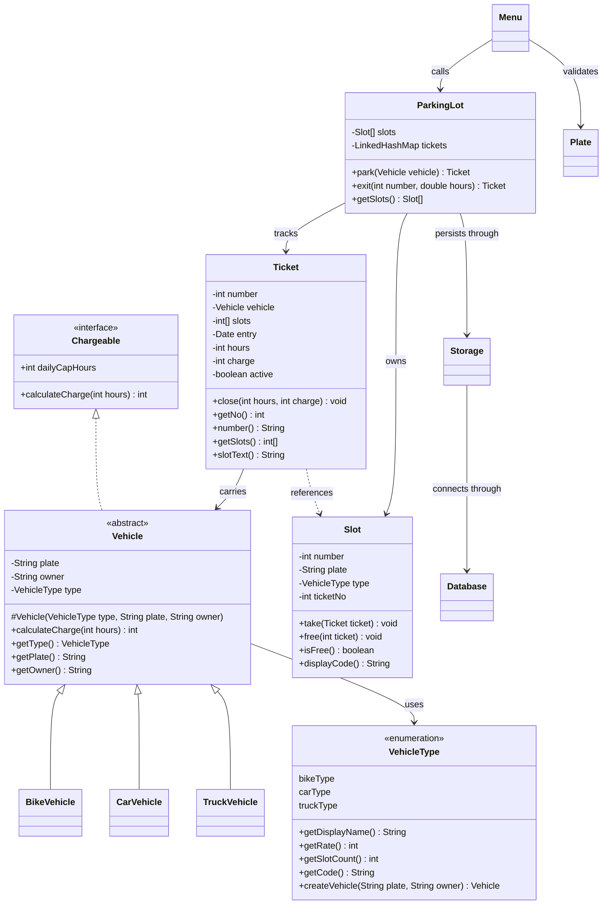

# ParkEase Technical Guide

ParkEase is a console parking application. It stores vehicles, tickets and slot state in
MySQL through JDBC.

## Runtime

| Item | Value |
|------|-------|
| Java | JDK 17 LTS or newer |
| Database | MySQL 8.4 LTS or 9.7 LTS |
| JDBC driver | MySQL Connector/J 26.7.0 |
| Interface | Console, plain text |
| Capacity | Fixed by `ParkingLot.capacity` |
| Currency | INR, integer charge |
| Time zone | Asia/Kolkata (IST) |
| Ticket format | `T-<number>` |
| Plate format | Indian plate format after normalization |

## Packages

| Package | Classes | Responsibility |
|---------|---------|----------------|
| `parkease` | `Main` | Starts the application and handles startup failure |
| `parkease.console` | `Menu` | Reads input, prints output, calls the service |
| `parkease.model` | `Chargeable`, `Vehicle`, `BikeVehicle`, `CarVehicle`, `TruckVehicle`, `VehicleType`, `Slot`, `Ticket` | Domain objects and billing contract |
| `parkease.service` | `ParkingLot` | Slot allocation, ticket creation and exit |
| `parkease.storage` | `Storage`, `Database` | MySQL persistence and JDBC configuration |
| `parkease.validation` | `Plate` | Plate validation and normalization |
| `parkease.exception` | Exception classes | Validation, parking and storage failures |

`Database` and the concrete vehicle subclasses are package-private.

## Class model



## Objects

| Class | State | Created by |
|-------|-------|------------|
| `Main` | None | JVM |
| `Menu` | `ParkingLot`, `Scanner`, `Plate`, date formatter, interactive flag | `Main` |
| `ParkingLot` | `Slot[]`, `LinkedHashMap<Integer, Ticket>`, `Storage` | `Main` |
| `Storage` | `Database`, date format, time zone, SQL strings | `Main` or a test caller |
| `Database` | JDBC URL and configuration lookup | `Storage` |
| `Plate` | None | `Menu` |
| `Vehicle` | Plate, owner, vehicle type | Through a subclass |
| `BikeVehicle` | Inherited vehicle state | `VehicleType.createVehicle` |
| `CarVehicle` | Inherited vehicle state | `VehicleType.createVehicle` |
| `TruckVehicle` | Inherited vehicle state | `VehicleType.createVehicle` |
| `VehicleType` | Display name, hourly rate, slot count, database code | Enum constants |
| `Slot` | Number, plate, vehicle type, ticket number | `ParkingLot` constructor |
| `Ticket` | Number, vehicle, slot numbers, entry, hours, charge, active flag | `ParkingLot.park` or `Storage.active` |
| Exception classes | Message and optional cause | Model, service, validation and storage code |

`Ticket.nextNumber` is static. `ParkingLot.capacity` is static final. `Chargeable.dailyCapHours`
is an interface constant.

## Runtime flow

- Startup: `Main` creates `Storage`, then `ParkingLot`. The `ParkingLot` constructor builds
  the slot table, initializes the schema, seeds slot rows, resumes ticket numbering and
  loads active tickets.
- Park: `Menu` validates the plate, `VehicleType` creates the vehicle, and
  `ParkingLot.park` allocates slots, creates the ticket, saves it, marks the slots and
  updates the active map.
- Exit: `ParkingLot.exit` finds the ticket, validates hours, applies rounding and the daily
  cap, saves the close, closes the ticket, frees the slots and removes the ticket.

## API reference

Public methods are listed below. Custom exceptions are checked; callers must catch them
or declare them with `throws`.

### `Main`

| Method | Returns | Throws | Purpose |
|--------|---------|--------|---------|
| `main(String[] args)` | `void` | None declared | Creates `Storage` and `ParkingLot`, starts `Menu`, closes `Scanner`, and exits with failure status on startup error |

`Main` catches `Exception` and prints a failure message.

### `Menu`

| Member | Returns | Throws | Purpose |
|--------|---------|--------|---------|
| `Menu(ParkingLot parking, Scanner reader)` | Constructor | None | Stores the service and input source; configures the IST formatter |
| `start()` | `void` | None declared | Prints the header and menu, reads choices, calls park, exit, slot map or summary |

Private helpers `park`, `exit` and `summary` declare `throws Exception`. `start` catches
and displays action errors.

### `ParkingLot`

| Method | Returns | Throws | Purpose |
|--------|---------|--------|---------|
| `ParkingLot(Storage storage)` | Constructor | `StorageException` | Builds the slot table, initializes MySQL, resumes ticket numbering and restores active tickets |
| `getCapacity()` | `int` | None | Returns the configured capacity |
| `park(Vehicle vehicle)` | `Ticket` | `ParkingFullException`, `DuplicateVehicleException`, `InvalidVehicleException`, `InvalidTicketException`, `InvalidSlotException`, `StorageException` | Rejects duplicates, allocates slots, creates and saves the ticket, and marks slots occupied |
| `exit(int number, double hours)` | `Ticket` | `InvalidTicketException`, `InvalidHoursException`, `InvalidSlotException`, `StorageException` | Closes an active ticket, applies billing and frees its slots |
| `find(int number)` | `Ticket` | None | Returns the active ticket, or `null` |
| `getSlots()` | `Slot[]` | None | Returns a copy of the slot array |
| `freeSlots()` | `int` | None | Counts free slots |
| `parked()` | `int` | None | Counts active tickets |
| `count(VehicleType type)` | `int` | None | Counts active tickets for a vehicle type |
| `total()` | `int` | `StorageException` | Returns all-time collection |
| `todayTotal()` | `int` | `StorageException` | Returns collection for the current IST date |
| `ticketCount()` | `int` | `StorageException` | Returns the stored ticket count |

`park` selects a free slot for a bike or car and a consecutive free pair for a truck. It
checks memory and MySQL before allocation. The ticket is saved before slots are marked in
memory.

`exit` requires positive, finite hours. It rounds with `Math.ceil`, then calls
`Chargeable.calculateCharge`, which applies `dailyCapHours`. Storage closes before memory
state changes.

### `Chargeable`

| Member | Type | Throws | Meaning |
|--------|------|--------|---------|
| `dailyCapHours` | `int`, implicitly `public static final` | None | Billable-hour cap |
| `calculateCharge(int hours)` | `int` | `InvalidHoursException` | Returns the charge for positive hours |

### `Vehicle`

`Vehicle` implements `Chargeable`.

| Member | Returns | Throws | Purpose |
|--------|---------|--------|---------|
| `protected Vehicle(VehicleType type, String plate, String owner)` | Constructor | `InvalidVehicleException`, `InvalidPlateException`, `InvalidOwnerException` | Validates and stores type, plate and owner |
| `calculateCharge(int hours)` | `int` | `InvalidHoursException` | Rejects non-positive hours, applies the cap and returns rate times billable hours |
| `getType()` | `VehicleType` | None | Returns the vehicle type |
| `getPlate()` | `String` | None | Returns the stored plate |
| `getOwner()` | `String` | None | Returns the owner name |

The constructor is protected. `Vehicle` is abstract and is not instantiated directly.

### Vehicle subclasses

| Member | Returns | Throws | Purpose |
|--------|---------|--------|---------|
| `BikeVehicle(String plate, String owner)` | Constructor, package-private | `InvalidVehicleException`, `InvalidPlateException`, `InvalidOwnerException` | Calls `super(VehicleType.bikeType, plate, owner)` |
| `CarVehicle(String plate, String owner)` | Constructor, package-private | `InvalidVehicleException`, `InvalidPlateException`, `InvalidOwnerException` | Calls `super(VehicleType.carType, plate, owner)` |
| `TruckVehicle(String plate, String owner)` | Constructor, package-private | `InvalidVehicleException`, `InvalidPlateException`, `InvalidOwnerException` | Calls `super(VehicleType.truckType, plate, owner)` |

The subclasses add no state or public methods. They inherit validation, billing and getters.

### `VehicleType`

| Constant | Display name | Rate | Slots | Database code |
|----------|--------------|------|-------|---------------|
| `bikeType` | Bike | 10 | 1 | `BIKE` |
| `carType` | Car | 30 | 1 | `CAR` |
| `truckType` | Truck | 60 | 2 | `TRUCK` |

| Method | Returns | Throws | Purpose |
|--------|---------|--------|---------|
| `getDisplayName()` | `String` | None | Returns the display name |
| `getRate()` | `int` | None | Returns the hourly rate |
| `getSlotCount()` | `int` | None | Returns the slot count |
| `getCode()` | `String` | None | Returns the database code |
| `createVehicle(String plate, String owner)` | `Vehicle` | `InvalidVehicleException`, `InvalidPlateException`, `InvalidOwnerException` | Creates the matching package-private subclass |

`createVehicle` is the public factory for vehicle objects.

### `Slot`

| Member | Returns | Throws | Purpose |
|--------|---------|--------|---------|
| `Slot(int number)` | Constructor | None | Creates a slot |
| `getNo()` | `int` | None | Returns the slot number |
| `isFree()` | `boolean` | None | Reports whether the plate is `null` |
| `displayCode()` | `String` | None | Returns `FREE` or the plate and vehicle code |
| `take(Ticket ticket)` | `void` | `InvalidSlotException` | Marks the slot occupied from the ticket and its vehicle |
| `free(int ticket)` | `void` | `InvalidSlotException` | Clears the slot when it belongs to the ticket |

`free` rejects a free slot or a ticket mismatch. `take` rejects an occupied slot.

### `Ticket`

| Member | Returns | Throws | Purpose |
|--------|---------|--------|---------|
| `Ticket(int number, Vehicle vehicle, int[] slots, Date entry)` | Constructor | `InvalidVehicleException`, `InvalidTicketException` | Validates vehicle, slots and entry; clones slots and entry date |
| `takeNextNumber()` | `int`, static | None | Returns the current number and increments the counter |
| `continueFrom(int lastNumber)` | `void`, static | None | Moves the counter past the highest stored number |
| `close(int hours, int charge)` | `void` | `InvalidTicketException` | Stores hours and charge; marks the ticket closed |
| `getNo()` | `int` | None | Returns the numeric ticket number |
| `number()` | `String` | None | Returns the `T-` prefixed ticket number |
| `getVehicle()` | `Vehicle` | None | Returns the vehicle |
| `getSlots()` | `int[]` | None | Returns a clone of the slot numbers |
| `slotText()` | `String` | None | Returns slot numbers joined by ` & ` |
| `getEntry()` | `Date` | None | Returns a copy of the entry time |
| `getHours()` | `int` | None | Returns billable hours after closing |
| `getCharge()` | `int` | None | Returns the charge after closing |

`Ticket` clones the slot array and entry date. `continueFrom` resumes numbering after
startup.

### `Plate`

| Method | Returns | Throws | Purpose |
|--------|---------|--------|---------|
| `check(String rawPlate)` | `String` | `InvalidPlateException` | Removes spaces, hyphens and tabs, uppercases the value and validates the plate layout |

The validator checks state letters, RTO digits, series letters and serial digits. It does
not verify real state or RTO codes. Example: `TN37AB1234`.

### `Storage`

`Storage` has an implicit public no-argument constructor.

| Method | Returns | Throws | Purpose |
|--------|---------|--------|---------|
| `init(int capacity)` | `void` | `StorageException` | Creates the schema and seeds slot rows for the configured capacity |
| `lastNo()` | `int` | `StorageException` | Returns the highest ticket number, or the base value when empty |
| `active()` | `List<Ticket>` | `StorageException` | Loads active tickets and their slot numbers ordered by ticket number |
| `parked(String plate)` | `boolean` | `StorageException` | Checks MySQL for an active ticket with the plate |
| `save(Ticket ticket)` | `void` | `StorageException` | Writes the vehicle and ticket rows and claims slot rows in a transaction |
| `close(Ticket ticket, int hours, int charge, Date exitTime)` | `void` | `StorageException` | Closes the ticket row and frees slot rows in a transaction |
| `total()` | `int` | `StorageException` | Sums charges for closed tickets |
| `todayTotal()` | `int` | `StorageException` | Sums charges for tickets closed on the current IST date |
| `ticketCount()` | `int` | `StorageException` | Counts stored tickets |

`save` and `close` disable auto-commit, roll back on failure and wrap the cause in
`StorageException`. A rollback failure is added as a suppressed exception.

### `Database`

`Database` is package-private.

| Method | Returns | Throws | Purpose |
|--------|---------|--------|---------|
| `connect()` | `Connection` | `StorageException` | Loads the JDBC driver and opens a connection from `.env` and environment values |

`Database` reads `PARKEASE_DB_URL`, `PARKEASE_DB_USER` and `PARKEASE_DB_PASSWORD`.
Environment variables override `.env`. Configuration is parsed into
`HashMap<String, String>`.

## Java data types

| Java type | Use |
|-----------|-----|
| `int` | Capacity, slot and ticket numbers, hours, charges, rates, counts and indexes |
| `double` | Exit hours before ceiling |
| `boolean` | Ticket state and control flags |
| `char` | Plate parsing and configuration quote checks |
| `String` | Plates, owners, messages, SQL, formatted dates and database codes |
| `Date` | Entry and exit timestamps |
| `VehicleType` | Vehicle category, rate, slot count and database code |
| `Slot[]` | Parking slot table |
| `int[]` | Ticket slot numbers |
| `String[]` | Split slot list and enum values |
| `List<Ticket>` | Return type for active tickets |
| `ArrayList<Ticket>` | Active-ticket load buffer |
| `LinkedHashMap<Integer, Ticket>` | Active tickets by number |
| `HashMap<String, String>` | Configuration values |
| `StringBuilder` | String assembly |
| `Scanner` | Console input |
| `Connection`, `Statement`, `PreparedStatement`, `ResultSet` | JDBC |
| `SimpleDateFormat`, `TimeZone`, `Locale` | Date formatting and case conversion |
| `Exception` subclasses | Checked errors |

Arrays hold the slot table and ticket slot numbers. `ArrayList` loads active tickets through
`List`. `LinkedHashMap` tracks active tickets. `HashMap` stores configuration. `Queue` is
unused because console operations are synchronous. `Properties`, `Hashtable`, `Vector`,
`HashSet` and `TreeMap` are not used.

## MySQL schema

The schema uses InnoDB and `utf8mb4`.

### `vehicles`

| Column | MySQL type | Null/default | Java mapping |
|--------|------------|--------------|--------------|
| `vehicle_number` | `VARCHAR(15)` | `NOT NULL`, primary key | `String` plate |
| `owner_name` | `VARCHAR(60)` | `NOT NULL` | `String` owner |
| `vehicle_type` | `VARCHAR(10)` | `NOT NULL`, check `BIKE`, `CAR`, `TRUCK` | `VehicleType.getCode()` |

### `tickets`

| Column | MySQL type | Null/default | Java mapping |
|--------|------------|--------------|--------------|
| `ticket_no` | `INT` | `NOT NULL`, primary key | `int` number |
| `vehicle_number` | `VARCHAR(15)` | `NOT NULL`, foreign key | `String` plate |
| `entry_time` | `DATETIME` | `NOT NULL` | `Date` entry |
| `exit_time` | `DATETIME` | `NULL` | `Date` exit, or `null` |
| `hours_parked` | `INT` | `NULL` | `int` hours after closing |
| `charge` | `INT` | `NULL` | `int` charge after closing |
| `status` | `VARCHAR(10)` | `NOT NULL DEFAULT 'ACTIVE'`, check `ACTIVE`, `CLOSED` | `Ticket.active` |

Indexes: `idx_tickets_vehicle_status (vehicle_number, status)` and
`idx_tickets_status (status)`.

### `slots`

| Column | MySQL type | Null/default | Java mapping |
|--------|------------|--------------|--------------|
| `slot_no` | `INT` | `NOT NULL`, primary key | `int` slot number |
| `ticket_no` | `INT` | `NULL`, foreign key with `ON DELETE SET NULL` | `Slot.ticketNo`; an unused number means free |

Index: `idx_slots_ticket (ticket_no)`.

### Type mapping

| Java value | MySQL value | Conversion |
|------------|-------------|------------|
| `String` plate or owner | `VARCHAR` | `PreparedStatement.setString` |
| `int` number, hours, charge or slot | `INT` | `PreparedStatement.setInt` |
| `Date` entry or exit | `DATETIME` | Formatted with `yyyy-MM-dd HH:mm:ss` in Asia/Kolkata |
| `VehicleType` | `VARCHAR` code | `getCode()` writes `BIKE`, `CAR` or `TRUCK`; `Storage.findType` reads it |
| `boolean` active | `status` text | `ACTIVE` or `CLOSED` |
| `int[]` ticket slots | Rows in `slots` | Each slot is a row; `GROUP_CONCAT` rebuilds the list |

The default JDBC URL uses `createDatabaseIfNotExist`. `Storage.init` creates tables and
seeds missing slot rows. Values bind through `PreparedStatement`; SQL text uses fixed
strings.

## Inheritance and abstraction

### `Chargeable`

```java
public interface Chargeable {

  int dailyCapHours = 8;

  int calculateCharge(int hours) throws InvalidHoursException;
}
```

`dailyCapHours` is implicitly `public static final`.

### `Vehicle`

```java
public abstract class Vehicle implements Chargeable {

  private String plate;
  private String owner;
  private VehicleType type;

  protected Vehicle(VehicleType type, String plate, String owner)
      throws InvalidVehicleException, InvalidPlateException, InvalidOwnerException {
    // validation and assignment
  }

  @Override
  public int calculateCharge(int hours) throws InvalidHoursException {
    // reject non-positive hours, apply the cap and multiply by the rate
  }
}
```

`Vehicle` is the only abstract class. It stores vehicle state and implements billing. The
class is abstract because a vehicle requires a concrete type. Billing is inherited; the
rate comes from `VehicleType`.

### Concrete subclasses

```java
class BikeVehicle extends Vehicle {

  BikeVehicle(String plate, String owner)
      throws InvalidVehicleException, InvalidPlateException, InvalidOwnerException {
    super(VehicleType.bikeType, plate, owner);
  }
}
```

`CarVehicle` and `TruckVehicle` use the same pattern. Constructors are package-private.
Application code calls `VehicleType.createVehicle`.

```text
Chargeable (interface)
    ^
    | implements
Vehicle (abstract)
    ^
    | extends
BikeVehicle, CarVehicle, TruckVehicle
```

### Polymorphism

`ParkingLot.exit` uses the interface type:

```java
Chargeable chargeable = ticket.getVehicle();
int amount = chargeable.calculateCharge(bill);
```

The reference is `Chargeable`; the object is a vehicle subclass. The call uses the
inherited implementation in `Vehicle`, and the rate comes from the object's `VehicleType`.

`VehicleType` is an enum factory. `Slot` and `Ticket` are concrete model classes.
`Storage` and `Database` use composition.

## Exceptions and `throws`

Custom exceptions are separate classes under `src/parkease/exception` and extend
`Exception`.

| Exception | Constructor | Condition |
|-----------|-------------|-----------|
| `ParkingFullException` | `ParkingFullException(String message)` | No free slot, or no consecutive pair for a truck |
| `DuplicateVehicleException` | `DuplicateVehicleException(String message)` | Plate has an active ticket in memory or MySQL |
| `InvalidVehicleException` | `InvalidVehicleException(String message)` | Vehicle or type is null or unknown; menu type is invalid |
| `InvalidPlateException` | `InvalidPlateException(String message)` | Plate is null, empty or malformed |
| `InvalidOwnerException` | `InvalidOwnerException(String message)` | Owner is null or empty |
| `InvalidTicketException` | `InvalidTicketException(String message)` | Ticket data is invalid, ticket is unknown, or ticket is already closed |
| `InvalidHoursException` | `InvalidHoursException(String message)` | Hours are non-positive, NaN or infinite |
| `InvalidSlotException` | `InvalidSlotException(String message)` | Slot is occupied, free, out of range or owned by another ticket |
| `StorageException` | `StorageException(String message)`, `StorageException(String message, Exception cause)` | Configuration, connection, setup, query, load, save or close fails |

`StorageException` preserves the original JDBC or parsing exception.

### `throws` matrix

| Method | Checked exceptions |
|--------|--------------------|
| `ParkingLot(Storage storage)` | `StorageException` |
| `ParkingLot.park(Vehicle vehicle)` | `ParkingFullException`, `DuplicateVehicleException`, `InvalidVehicleException`, `InvalidTicketException`, `InvalidSlotException`, `StorageException` |
| `ParkingLot.exit(int number, double hours)` | `InvalidTicketException`, `InvalidHoursException`, `InvalidSlotException`, `StorageException` |
| `ParkingLot.total()` | `StorageException` |
| `ParkingLot.todayTotal()` | `StorageException` |
| `ParkingLot.ticketCount()` | `StorageException` |
| `Storage.init(int capacity)` | `StorageException` |
| `Storage.lastNo()` | `StorageException` |
| `Storage.active()` | `StorageException` |
| `Storage.parked(String plate)` | `StorageException` |
| `Storage.save(Ticket ticket)` | `StorageException` |
| `Storage.close(Ticket ticket, int hours, int charge, Date exitTime)` | `StorageException` |
| `Storage.total()` | `StorageException` |
| `Storage.todayTotal()` | `StorageException` |
| `Storage.ticketCount()` | `StorageException` |
| `Database.connect()` | `StorageException` |
| `Vehicle(VehicleType type, String plate, String owner)` | `InvalidVehicleException`, `InvalidPlateException`, `InvalidOwnerException` |
| `Vehicle.calculateCharge(int hours)` | `InvalidHoursException` |
| `VehicleType.createVehicle(String plate, String owner)` | `InvalidVehicleException`, `InvalidPlateException`, `InvalidOwnerException` |
| `Ticket(int number, Vehicle vehicle, int[] slots, Date entry)` | `InvalidVehicleException`, `InvalidTicketException` |
| `Ticket.close(int hours, int charge)` | `InvalidTicketException` |
| `Slot.take(Ticket ticket)` | `InvalidSlotException` |
| `Slot.free(int ticket)` | `InvalidSlotException` |
| `Plate.check(String rawPlate)` | `InvalidPlateException` |
| `Menu.start()` | None declared; action errors are caught |
| `Main.main(String[] args)` | None declared; startup errors are caught |

### Exception flow

- `Menu` catches `ParkingFullException` and `Exception`, prints the message and continues.
- `Main` catches startup errors, prints a message and exits with failure status.
- `Storage` wraps JDBC and parsing failures in `StorageException`; `save` and `close`
  roll back before wrapping.
- `ParkingLot.park` writes the ticket before marking slots. `ParkingLot.exit` writes the
  close before releasing slots. A storage failure leaves memory unchanged.

Custom exceptions are checked because they extend `Exception`. No custom unchecked
exception is defined. Input parsing and SQL exceptions are caught at the boundary and
converted or wrapped.

## Example

```java
static void example(double hours) throws Exception {
  Storage storage = new Storage();
  ParkingLot parking = new ParkingLot(storage);

  Vehicle vehicle = VehicleType.carType.createVehicle("TN37AB1234", "Asha");
  Ticket ticket = parking.park(vehicle);

  Ticket closed = parking.exit(ticket.getNo(), hours);
  int amount = closed.getCharge();
}
```

`hours` is rounded up, and the daily cap limits billable hours.

## Related files

- `README.md` - build, configuration, menu, parking rules and database setup.
- `sql/schema.sql` - manual MySQL schema.
- `src/parkease/model` - interface, abstract class, subclasses and domain objects.
- `src/parkease/service/ParkingLot.java` - slot allocation and exit workflow.
- `src/parkease/storage` - JDBC persistence and configuration.
- `src/parkease/exception` - checked exception classes.
